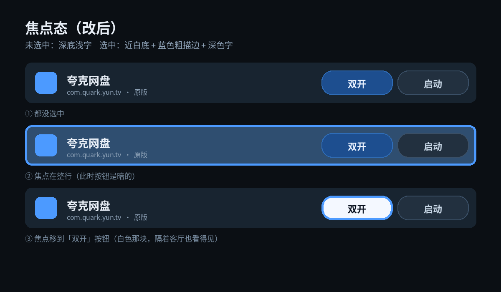

# 双开管家 · TV Clone

在 Android TV / 电视盒子上，对着任意已安装应用点一下「双开」，**本机现场重打包并安装出第二份**。
不需要 root，不需要电脑配合，不联网，不上传任何 APK。

桌面会出现「夸克网盘」和「夸克网盘 ①」两个图标，各自独立登录、独立数据。



## 功能

- **端上双开**：选应用 → 生成 `.clone1` → 系统安装，全程在电视里完成（约 0.1–1 秒/个）
- **配对管理**：已装应用按「原版 / 克隆①」分组显示，可直接启动或卸载克隆
- **不改 dex**：只改二进制清单与 `resources.arsc`，类名保持原样
- **无第三方依赖**：不引 AndroidX、不引 apksig，自实现 AXML 改写与 APK v2 签名
- **附带电脑端 CLI**：`pc/tvclone.sh`，批量出包 / 校验 / adb 安装，调试与批量场景用

## 安装

从 [Releases](../../releases) 下载 `TvDualManager-vX.Y.Z.apk`：

```bash
adb install -r TvDualManager-v2.0.4.apk
```

或拷到 U 盘，用电视自带的文件管理器安装（需允许「未知来源」）。

**系统要求：Android 7.0 及以上。** 克隆包只带 v2 签名，5.x / 6.x 装不上。

## 使用

1. 打开「双开管家」，主界面就是已安装应用列表
2. 遥控器焦点移到目标应用右侧的「双开」，按 OK
3. 看到进度提示 → 系统安装确认 → 完成
4. 回桌面，多出一个「应用名 ①」的图标，登录另一个账号即可

再点一次「双开」会生成 ②，最多 9 份。克隆条目右侧有「卸载」，卸克隆不影响原版。

## 工作原理

```
已装应用的 base.apk
  ├─ Axml.rewrite        改二进制清单：package / authorities / 相对类名展开 / 去 sharedUserId / 改桌面名
  ├─ Arsc.renamePackage  改 resources.arsc 里的包名（固定 128 字符字段，原地覆盖，不动偏移）
  ├─ ApkZip.repack       流式重打包：剥掉旧 v1 签名，清单与 arsc 用 STORED，.so 16KB 页对齐
  └─ V2Signer.signFile   自实现 APK Signature Scheme v2（纯 JDK/Android API）
       └─ PackageInstaller / ACTION_VIEW 交给系统安装
```

**关键取舍：完全不碰 dex。** 改包名时把清单里的 `.App` 展开成 `com.old.pkg.App`
（Android 允许组件类不在 manifest 包名之下），因此不需要重写字节码、不需要 dexlib2。
代价是 `Class.forName(getPackageName() + ".X")` 这类自省写法会失效。

v2 签名是自己实现的，踩过的三个坑都写在代码注释里：

1. `digests` / `signatures` 的每条记录要**多一层长度前缀**；
2. 签名覆盖的是 signed-data 的**内容**，不含它自己的长度前缀；
3. 算摘要时 EOCD 的「中央目录偏移」要替换成**签名块起始位置**，但写进文件的必须是真实偏移。

## 限制

| 情况 | 结果 |
|---|---|
| Android 5.x / 6.x | 装不上（只签了 v2） |
| 分卷安装的应用（App Bundle 拆包） | 不支持，会直接提示 |
| 加固壳（360/腾讯乐固/梆梆）、支付、微信登录、DRM 片源 | 克隆后失效或闪退，签名变了 |
| 需要覆盖升级原版 | 不行，签名不同只能共存 |

克隆包用内置证书签名（见 `app/assets/README.md`），与原版签名不同是设计使然——
这正是它能和原版并存的原因。

## 从源码构建

### 电视端 APK

依赖：JDK 8+、Android SDK（build-tools 34 以上，推荐 36）、python3 + Pillow（只用于生成图标和 banner）。

```bash
./app/build.sh
# 产物: app/build/TvDualManager.apk
```

首次构建会自动生成 `app/release.jks`（APK 的签名钥匙）。**换钥匙 = 必须先卸载重装**，请自行保管。

### 电脑端 CLI

```bash
./pc/tvclone.sh doctor                  # 检查 SDK / apktool / 签名工具
./pc/tvclone.sh inspect 某个应用.apk     # 判断能不能克隆（加固包会拦下）
./pc/tvclone.sh clone 某个应用.apk -n 2  # 出 .clone1 / .clone2
./pc/tvclone.sh verify out/xxx.clone1.apk --old-pkg com.xxx
```

需要 `apktool` 2.7+。电脑端走 apktool 路线，与端上实现是两套独立方案，互为验证。

## 目录

```
app/                 电视端 APK
  core/com/tvdual/core/   纯 Java 核心：Axml / Arsc / ApkZip / V2Signer / Cloner
  core/test/RunClone.java 桌面测试台：同一份代码在电脑上跑，产物用 apksigner 验
  src/com/tvdual/manager/ 电视 UI（MainActivity / Apps / Ui / CloneProvider）
  assets/                 克隆包签名密钥（公开材料，见其 README）
pc/                  电脑端 CLI（Python）
  tvclone/                sdk / apkmeta / rewrite / engine / cli
samples/             结构完整的测试 App，用于回归（provider、sharedUserId、相对类名）
tools/               dump_sigblock.py：解析 APK 签名块，调试 v2 签名用
docs/                截图
```

## 常见问题

**装的时候提示「解析软件包时出现问题」**
2.0.3 之前有这个 bug（克隆包交给安装器的路径不对）。升级到最新版即可。

**安装时提示「应用未安装」/ 冲突**
克隆包与原版签名不同，不能覆盖。确认装的是带 `.clone1` 包名的那份，且原版仍在。

**克隆成功但打开闪退**
该应用有签名校验或加固壳。用 `pc/tvclone.sh inspect` 看是否被判定为加固包。
这类应用重打包后必然失效，是路线的物理上限。

**焦点看不清**
2.0.4 起改为「选中 = 近白底 + 蓝色粗描边」，见顶部截图。

## Roadmap

- [ ] v1（JAR）签名，把支持范围拉回 Android 5.0
- [ ] 分卷 APK（App Bundle）合并后克隆
- [ ] 克隆后可选自动创建桌面快捷方式

## License

[MIT](LICENSE)
